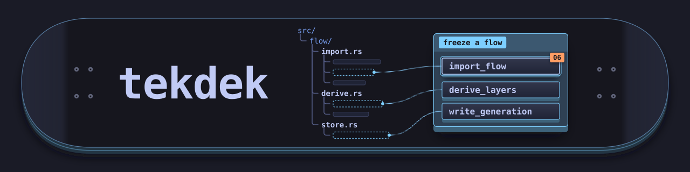
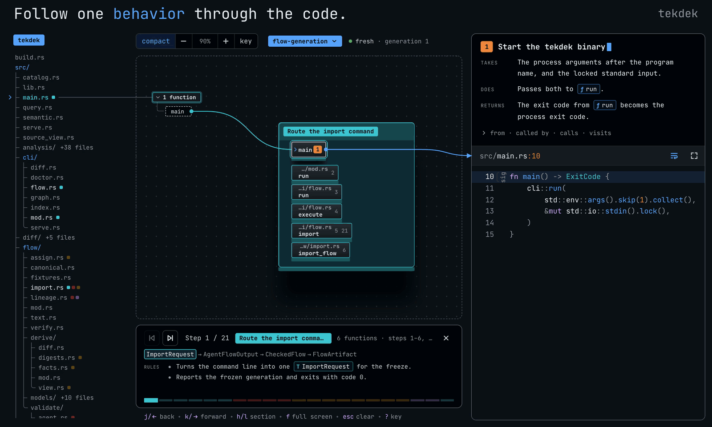

<p align="center">
  
</p>

# Tekdek

## Demo

<p align="center">
  <a href="docs/assets/demo.mp4"></a>
</p>

The demo plays a flow through the source of tekdek, then opens the diff of one pull request in that flow. Select the preview to open the full-size video.

## Overview

- Purpose: help engineers follow one behavior of a codebase. The file tree stays in view and anchors their understanding of the project.
- Scope: Rust, Python, TypeScript, and JavaScript indexing, agent-written flows with clusters, PR diffs of a flow, the Lift Deck viewer, installers, and a plugin for Claude Code and Codex.
- Approach: index the source into a graph, let a coding agent write a flow against the graph, freeze the flow, and play it in the browser.
- Boundaries: a flow explains ordered visits to functions and never changes the source facts. Lines show static calls, not runtime counts.
- Outcome: a frozen, shareable flow that plays the same way for every reader.

## Install

Install the plugin in your coding agent. It adds the `flow`, `flow-view`, and `diff` skills, and its launcher downloads the `tekdek` binary of the plugin version on the first run, so no other install is needed.

- Claude Code:

  ```text
  /plugin marketplace add dychen1/tekdek
  /plugin install tekdek@tekdek
  ```

- Codex:

  ```sh
  codex plugin marketplace add dychen1/tekdek
  codex plugin add tekdek@tekdek
  ```

Then ask for a flow, for example `/tekdek:flow explain how a request is authenticated` in Claude Code. The skill indexes the project and asks before it installs a missing language server.

[Install](docs/install.md) has the plugin details, the installers of the CLI alone, the build from source, and the language servers.

## Quick Start

Open the demo from a checkout: a flow that explains how this tool freezes a flow, played against the graph of this repository.

```sh
npm ci
cargo run --release --locked -- serve --store demo --flow flow-generation --open
```

The command builds tekdek from the checkout, so the binary reads the flow schema of the demo store. A release binary can be older than the store, and it then skips the flow.

Press the right arrow to start the flow. Press `?` to show the key.

## Workflow

1. Index the project: run `tekdek index` in the project root. It parses the source, so it takes seconds or less.
2. Ask a coding agent for a flow, for example `/tekdek:flow explain how a request is authenticated`. The agent finds node keys with `tekdek graph search` and `tekdek graph show`, writes an output document with clusters, checks it with `tekdek flow import --check`, and freezes it with `tekdek flow import`.
3. View the flow with `/tekdek:flow-view request-auth` or `tekdek serve --flow request-auth --open`.
4. On a PR branch, ask for a diff only when you need one, for example `/tekdek:diff request-auth`. See [PR Diffs](docs/diffs.md).

Every command uses the nearest `.tekdek` folder from the working directory. The search stops at the top folder of the Git work tree, and it does not go up into your home folder. Pass `--store <directory>` to use another store.

## Documentation

| Page | Contents |
| --- | --- |
| [Install](docs/install.md) | The plugin and its launcher, the CLI installers, the build from source, and the language servers. |
| [Project Store](docs/store.md) | The `.tekdek` folder: graphs, flows, generations, and what to commit. |
| [Frozen Flows](docs/flows.md) | What the agent writes, what code derives, and how a flow is checked, frozen, and verified. |
| [PR Diffs](docs/diffs.md) | How a diff of one behavior is prepared, frozen, verified, and viewed. |
| [Lift Deck](docs/lift-deck.md) | The parts of the viewer, the keys, the URL, and what `tekdek serve` reads. |
| [Analysis](docs/analysis.md) | What `tekdek index` records for each language, and how semantic edges come from the language servers. |
| [CLI Reference](docs/cli.md) | Every command, the exit codes, and the configuration file. |
| [Development](docs/development.md) | The project structure, the checks, and the release steps. |

## Development

```sh
npm ci
make check
```

`make check` runs the format check, the lints, the TypeScript check, and both test suites. See [Development](docs/development.md).
