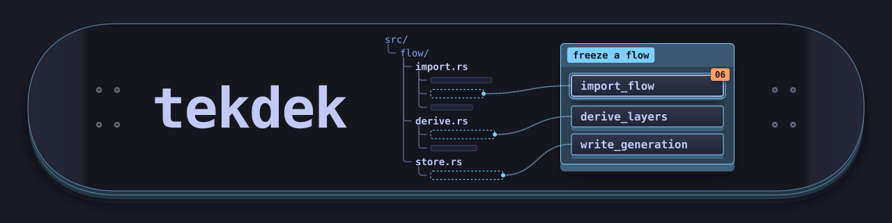

<p align="center">
  
</p>

# Tekdek

## Overview

- Purpose: help engineers follow one behavior of a codebase while the file structure stays in view.
- Scope: Rust and Python indexing, agent-written flows with clusters, the Lift Deck viewer, installers, and a Claude Code plugin.
- Approach: index the source into a graph, let a coding agent write a flow against the graph, freeze the flow, and play it in the browser.
- Boundaries: a flow explains ordered visits to functions and never changes the source facts. Lines show static calls, not runtime counts.
- Outcome: a frozen, shareable flow that plays the same way for every reader.

## Install

- macOS and Linux:

  ```sh
  curl --proto '=https' --tlsv1.2 -LsSf https://github.com/dychen1/tekdek/releases/latest/download/tekdek-installer.sh | sh
  ```

- Windows (PowerShell):

  ```powershell
  powershell -ExecutionPolicy Bypass -c "irm https://github.com/dychen1/tekdek/releases/latest/download/tekdek-installer.ps1 | iex"
  ```

- From source, with Rust and Node.js 22 or later:

  ```sh
  git clone https://github.com/dychen1/tekdek && cd tekdek
  npm ci
  cargo install --locked --path .
  ```

The installers need no Rust or Node.js. They put `tekdek` in `$XDG_BIN_HOME`, else `$XDG_DATA_HOME/../bin`, else `~/.local/bin`, and add that folder to `PATH`. They download from GitHub Releases, so they work only after the repository becomes public. Until then, use `gh release download --repo dychen1/tekdek` or build from source.

Install the agent skills in Claude Code:

```text
/plugin marketplace add dychen1/tekdek
/plugin install tekdek@tekdek
```

The plugin adds `/tekdek:flow` and `/tekdek:flow-view`, which call the `tekdek` binary. For the private repository, Claude Code uses your git credentials (`gh auth login`, then `gh auth setup-git`). Other coding agents can follow `plugin/skills/flow/SKILL.md`.

## Language Servers

`tekdek index` gets calls and references from a language server. The other commands need no language server.

| Language | Indexed | Server | Install |
| --- | --- | --- | --- |
| Rust | Yes | `rust-analyzer` | `rustup component add rust-analyzer`, `brew install rust-analyzer`, or a [release binary](https://github.com/rust-lang/rust-analyzer/releases) |
| Python | Yes | `pyright-langserver` | `npm install -g pyright`, or without Node.js: `uv tool install 'pyright[nodejs]'` or `pipx install 'pyright[nodejs]'` |
| TypeScript and JavaScript | Not yet | `typescript-language-server` | `npm install -g typescript-language-server typescript@6` |
| Go | Not yet | `gopls` | `go install golang.org/x/tools/gopls@latest` |

- `tekdek doctor` prints the path and version of each server, or the install command of a missing server.
- Pass a server that is not on `PATH` with `--server`, for example `tekdek index --server python=.venv/bin/pyright-langserver`.
- `tekdek index` skips the files of a language that it does not index yet. Request a language in [issue #4](https://github.com/dychen1/tekdek/issues/4).
- `/tekdek:flow` looks for a local server first and asks before it installs one, for example `pyright needed for project acme-api - ~20 MB. y or n to download and install?`.

## Quick Start

Open the demo from a checkout: a flow that explains how this tool freezes a flow, played against the graph of this repository.

```sh
tekdek serve --store demo --flow flow-generation --open
```

Press the right arrow to start the flow. Press `?` to show the key.

## Workflow

1. Index the project: run `tekdek index` in the project root.
2. Ask a coding agent for a flow, for example `/tekdek:flow explain how a request is authenticated`. The agent finds node keys with `tekdek graph search` and `tekdek graph show`, writes an output document with clusters, checks it with `tekdek flow import --check`, and freezes it with `tekdek flow import`.
3. View the flow with `/tekdek:flow-view request-auth` or `tekdek serve --flow request-auth --open`.

Every command uses the nearest `.tekdek` folder from the working directory. The search stops at the top folder of the Git work tree, and it does not go up into your home folder. Pass `--store <directory>` to use another store.

## Project Store

`tekdek index` writes to the nearest `.tekdek` folder at or above the root. When the project has no store, `index` creates `<root>/.tekdek` after the analysis succeeds. Commit the folder to share flows.

- In a project that has a store, `tekdek index` without a root indexes the project root from any subfolder, as Git commands do. The project root is the folder that holds the store.
- A root argument inside that project needs `--name`, so a partial graph never replaces the project graph: `tekdek index services/worker --name worker` writes `worker.json`.

```text
acme-api/
|-- src/
`-- .tekdek/
    |-- .gitignore                      # ignores the lock file, interrupted writes, and index.json
    |-- acme-api.json                   # graph of the project, from tekdek index
    `-- flows/
        |-- request-auth/
        |   |-- current.json            # names the current generation
        |   `-- generations/
        |       |-- 1-3f9a0c1d2e4b.json # first freeze
        |       `-- 2-8b21d0e7aa13.json # revision of 1, now current
        `-- billing-webhook/
            |-- current.json
            `-- generations/
                `-- 1-c0d4e5f60718.json
```

- A flow is one folder. Each freeze adds one generation file, named by its ordinal and the first 12 characters of its digest. A generation never changes after the freeze. `current.json` names the current generation.
- The graph belongs to the store, not to one flow. All flows of a project share its graph.
- The catalog of graphs and current flows is not a file in the store. `tekdek serve` builds it from the store for each request, so two branches that add flows merge without a conflict. An `index.json` file from an older tekdek has no effect; delete it.
- The default graph is the only graph, else the graph named after the project folder, else the first graph in name order. A named index does not change the default. The `graph` commands and the viewer use the default when you do not name a graph.
- A flow binds to the digest of its graph, so commit the graph with its flows. When you index changed source again, the digest changes and the flows become stale. A stale flow still plays, with a warning. To follow the new graph, write the flow again under a new name.

## Frozen Flows

The agent names 1 to 8 clusters for the phases of a flow and labels each step with one cluster. Code derives the rest: function membership, cluster colors, visit runs, static call transitions, step IDs, and digests. The same agent output on the same graph always freezes the same bytes, except the provenance.

- `flow agent-contract` prints the JSON Schema of the agent output.
- `flow import` validates the complete output and freezes one generation. On any error, it prints every issue and writes nothing. `--check` runs the complete import and writes nothing.
- A new name freezes an `initial` generation. An existing name freezes a `revision` with a diff against its parent, on the graph of the parent.
- `flow verify` recomputes the derived layers and digests. An edited generation fails with `digest_mismatch`.

## Lift Deck

The viewer shows the codebase as one vertical file tree. When a flow starts, the tree opens the path to each function of the flow once. Then the tree does not move until you clear the flow. Each cluster lifts its functions onto a raised colored deck, with tethers to their places in the tree. The callout describes the current cluster, and the controls show the step title and annotation.

| Key | Action |
| --- | --- |
| Left and Right | Previous or next step |
| Esc | Close the key, then clear the flow |
| F | Fit the map |
| ? | Show or hide the key |

The URL keeps the graph, the flow, and the step: `?artifact=<file>&flow=<name>&step=<n>`. `tekdek serve` binds to the loopback address, serves the viewer from the binary, and reads only the store files that its catalog lists: the graph files and the current generation of each flow.

## Language Analysis

- The file extension selects the adapter: `.rs` for Rust, and `.py` and `.pyi` for Python. A `.py` file wins over a matching `.pyi` file.
- A parser makes the syntax facts, which define all graph nodes: `syn` for Rust and the RustPython parser for Python. The language server adds the call, reference, and type edges.
- Edges connect nodes of the same language only. Symbols outside the source root make no edges.
- The Rust parser does not expand macros or evaluate conditional compilation. The default rust-analyzer profile disables build scripts, procedural macros, check on save, and cache priming.
- When one adapter fails, `index` writes no graph.

## CLI Reference

```text
tekdek index [<root>] [--name <name>] [--store <directory>] | [--output <path>]
  [--config <path>]
  [--server <language>=<program>]
  [--server-arg <language>=<argument>]...

tekdek graph search <text> [--kind module|type|callable|field] [--limit <n>]
tekdek graph show <key>

tekdek flow list [--graph <file>]
tekdek flow show <name>
tekdek flow import <name> --graph <file> --input <path or -> [--check]
  [--author agent|human|system] [--author-name <name>] [--model-id <id>]
tekdek flow verify <name>
tekdek flow agent-contract

tekdek serve [--store <directory>] [--port <n>] [--flow <name>] [--open]
tekdek doctor [--config <path>] [--json]
tekdek help
tekdek version
```

The `graph` and `flow` commands accept `--store <directory>` and `--json`. `--graph` takes a file name inside the store. JSON mode returns one document, also for errors. Write `--option=value` for a value that starts with a hyphen.

| Command | Notes |
| --- | --- |
| `index` | The default root is the working directory, and the default name is the root folder name. `--output` writes one graph and changes no index. `--server` replaces a server program, and each `--server-arg` replaces the server arguments in order. |
| `graph search` | Lists the keys that contain every word, best name match first. The default limit is 20. |
| `graph show` | Shows the signature, documentation summary, container, members, callers, and callees. A missing key names close keys. |
| `flow list` | Lists the current generation of each flow, with its freshness. |
| `flow import` | Returns 1 for a `no_flow` answer and 2 for a rejected output. `--author-name` alone records an agent author. |
| `flow verify` | Returns 1 when it finds an issue. |
| `serve` | Serves on `127.0.0.1:8000` by default. Port 0 selects a free port. `--flow` prints the URL of one flow, and `--open` opens it. |
| `doctor` | Returns 1 when an enabled language has no server. |

## Configuration

tekdek reads `tekdek/config.toml` in the configuration directory of the operating system (on macOS, `~/Library/Application Support/tekdek/config.toml`), or the file that `--config <path>` names. It never reads a configuration from the analyzed repository. Inspect a `--config` file before you use it.

Each `[languages.<name>]` table can set `enabled`, `extensions`, `language_id`, `program`, `arguments`, and `initialization_options`. CLI options override the file, and the file overrides the built-in settings.

```toml
[languages.python]
program = "pyright-langserver"
arguments = ["--stdio"]

[languages.rust.initialization_options]
checkOnSave = false
cargo.buildScripts.enable = false
procMacro.enable = false
cachePriming.enable = false
```

`initialization_options` replaces the complete built-in object. For Rust, keep the four safety settings of this example.

## Project Structure

```text
.
|-- Cargo.toml                 # Crate metadata and dependencies
|-- build.rs                   # Bundles the viewer script for the binary
|-- dist-workspace.toml        # Release configuration for cargo-dist
|-- Makefile                   # serve, demo, build, index, test, check
|-- src/
|   |-- main.rs                # Binary entry
|   |-- lib.rs                 # Library modules
|   |-- cli/                   # Command routing and the index, graph, flow, serve, and doctor commands
|   |-- analysis/              # Indexer: pipeline, preflight, configuration, sources
|   |   |-- fact/              # Syntax and semantic fact models
|   |   |-- graph/             # Graph models and construction
|   |   |-- language/          # Python and Rust adapters and their profiles
|   |   `-- lsp/               # Language server client, session, and capture
|   |-- store/                 # Store folder, project store, atomic writes, graph artifact
|   |-- flow/                  # Frozen flows: models, import, verify, lineage, rules
|   |   `-- schema/            # Agent output and flow artifact JSON Schemas
|   |-- catalog.rs             # catalog of graphs and flows for the viewer
|   |-- query.rs               # Graph search and node neighbors for agents
|   `-- serve.rs               # Viewer server with the embedded viewer
|-- tools/build-viewer.ts      # esbuild script that build.rs runs
|-- viewer/
|   |-- index.html             # Lift Deck page
|   |-- src/                   # Strict TypeScript: data, layout, deck
|   |-- styles/deck.css        # Tokens and styles
|   |-- fonts/                 # JetBrains Mono latin subset (SIL OFL 1.1)
|   `-- tests/                 # Viewer tests
|-- demo/                      # Demo store: this repository's graph and one flow
|-- .claude-plugin/            # Claude Code marketplace
|-- plugin/                    # Claude Code plugin: the flow and flow-view skills
`-- .github/                   # Release workflow and its build setup steps
```

## Development

```sh
npm ci
make check
```

`make check` runs `cargo fmt --check`, `cargo clippy --locked --all-targets --all-features`, the TypeScript check, `cargo test --locked --all-targets`, and `npm test`. `make test` runs the two test suites only. `make demo` serves the demo store, `make serve` serves the nearest `.tekdek` folder (`STORE=<directory>` for another store), and `make index SOURCE=<root>` indexes a codebase. `PORT=8001` selects another port.

Every Cargo build runs `build.rs`, which bundles `viewer/src` with esbuild. A build without `npm ci` fails with a message that says to run it.

## Releases

1. Set the same version in `Cargo.toml` and `plugin/.claude-plugin/plugin.json`. A test fails when they differ.
2. Merge the change to `main`.
3. Tag the commit on `main` and push the tag: `git tag v0.2.0 && git push origin v0.2.0`.

The release workflow builds archives and installers for macOS (arm64 and x86_64), Linux (x86_64 and arm64), and Windows (x86_64), and publishes them on GitHub Releases. It stops when the tag does not point to a commit on `main`. Claude Code users get the plugin update when the plugin version changes.
